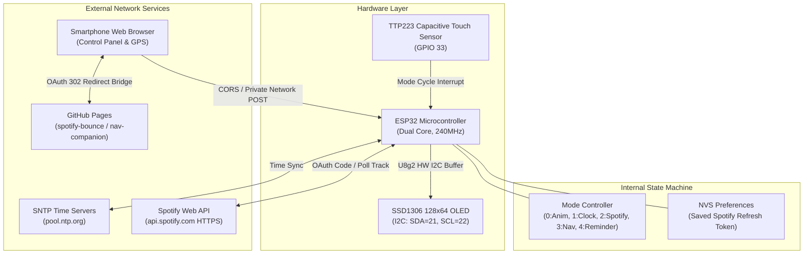

# ESP32 Multifunction OLED Display and Navigation Companion

A versatile embedded display workstation powered by an ESP32 microcontroller and an SSD1306 128x64 I2C OLED screen. The device features five switchable operating modes controlled via a capacitive touch sensor, an asynchronous mobile-friendly web control portal, real-time Spotify playback monitoring, live turn-by-turn GPS navigation streaming via Google Maps, an NTP-synchronized digital clock, and a wireless digital memo and drawing pad.

---

## Table of Contents

1. [System Overview](#system-overview)
2. [Operating Modes](#operating-modes)
3. [System Architecture](#system-architecture)
4. [Hardware Requirements and Pinout](#hardware-requirements-and-pinout)
5. [Prerequisites and Dependencies](#prerequisites-and-dependencies)
6. [Critical Flash Partition Requirement](#critical-flash-partition-requirement)
7. [Installation and Build Instructions](#installation-and-build-instructions)
   - [Option A: Arduino IDE](#option-a-arduino-ide)
   - [Option B: PlatformIO](#option-b-platformio)
8. [Configuration and Onboarding](#configuration-and-onboarding)
   - [1. Initial WiFi Configuration](#1-initial-wifi-configuration)
   - [2. Spotify Integration Setup](#2-spotify-integration-setup)
   - [3. Navigation Companion Setup](#3-navigation-companion-setup)
9. [Web Control Panel](#web-control-panel)
10. [Repository Structure](#repository-structure)
11. [Troubleshooting Guide](#troubleshooting-guide)
12. [License and Contributing](#license-and-contributing)

---

## System Overview

The firmware operates in dual WiFi mode (`WIFI_AP_STA`), simultaneously serving as an Access Point (`ESP32-Setup`) for local administration while maintaining a Station connection to a local wireless network for internet access. 

All user-facing operations are non-blocking and driven by an asynchronous event loop that schedules display rendering, sensor debouncing, HTTP request handling, and TLS API queries without stalling the processor.

---

## Operating Modes

Operating modes are cycled in sequence using a hardware capacitive touch sensor or push button connected to GPIO 33:

`Animation -> Clock -> Spotify -> Navigation -> Reminder -> Animation`

| Mode | Function | Key Technical Highlights |
|:---|:---|:---|
| **0. Animation Player** | Renders high-frame-rate pixel animations | 7 selectable animation sets stored as 1-bit XBM arrays in PROGMEM flash. Frame switching selectable on the fly via the web control panel. |
| **1. Digital Clock** | Displays real-time clock and date | Synchronized via SNTP with automatic fallback to client epoch injection from connected smartphones. Independent font selection for time and date from built-in U8g2 typefaces. Timezone UTC offset configurable via web UI. |
| **2. Spotify Now Playing** | Real-time track monitor and progress ticker | Authenticates directly against the Spotify Web API via OAuth 2.0. Renders scrolling track title marquee, truncated artist label, elapsed and remaining playback timers, and dynamic progress bar. Persistent session tokens stored in ESP32 Non-Volatile Storage (NVS). |
| **3. Turn-by-Turn Navigation** | Heads-up directional navigation display | Relays real-time maneuver instructions (arrows rotated at cardinal and intermediate angles) and distance countdowns from a browser-based companion app powered by Google Maps Directions API. Stale data auto-expiration after 15 seconds. |
| **4. Reminder and Drawing Pad** | Wireless memo and sketchpad | Displays alphanumeric text reminders with optional marquee horizontal scroll, or receives 1024-byte hand-drawn 128x64 monochrome sketches submitted from an HTML5 canvas element in the web dashboard. |

---

## System Architecture



---

## Hardware Requirements and Pinout

### Required Components

- **Microcontroller:** ESP32-WROOM-32 (NodeMCU / DevKit v1 or equivalent).
- **Display:** 0.96-inch or 1.3-inch monochrome I2C OLED display (SSD1306 / SH1106 controller, 128x64 resolution).
- **Touch Input:** TTP223 capacitive digital touch module or standard tactile push button.
- **Power Supply:** 5V USB power source (minimum 500mA rating).

### Pin Connections

| Module Pin | ESP32 GPIO | Description |
|:---|:---|:---|
| **OLED SDA** | GPIO 21 | Hardware I2C Serial Data line |
| **OLED SCL** | GPIO 22 | Hardware I2C Serial Clock line |
| **OLED VCC** | 3.3V or VIN | Power input (check module voltage regulator) |
| **OLED GND** | GND | Common system ground |
| **TTP223 SIG** | GPIO 33 | Digital touch sensor output (active HIGH) |
| **TTP223 VCC** | 3.3V | Touch sensor power input |
| **TTP223 GND** | GND | Common system ground |

For detailed wiring schematics and electrical guidance, refer to [docs/HARDWARE.md](file:///C:/Users/anurag/Desktop/web/reference/github/navigator%2001/docs/HARDWARE.md).

---

## Prerequisites and Dependencies

### Arduino IDE Libraries

The firmware relies on standard built-in ESP32 core libraries and one external display driver:

- **U8g2** (by olikraus, version 2.35.x or newer): Required for fast graphics rendering and font management.
- **WiFi** (built-in ESP32 core): Network station and soft-AP management.
- **WebServer** (built-in ESP32 core): HTTP server for the embedded portal.
- **WiFiClientSecure** (built-in ESP32 core): TLS client for Spotify HTTPS requests.
- **HTTPClient** (built-in ESP32 core): REST request orchestration.
- **Preferences** (built-in ESP32 core): Non-volatile storage management.
- **Wire** (built-in ESP32 core): Hardware I2C communication.

---

## Critical Flash Partition Requirement

The firmware embeds seven animation sequences compiled as C arrays in `PROGMEM`. Together with font tables and the web application payload, the binary assets total approximately 1.8 MB.

If compiled using the default Arduino IDE partition scheme (`Default 4MB with spiffs - 1.2MB APP / 1.5MB SPIFFS`), compilation will fail with a linker overflow error:

```
text section exceeds available space in board
```

### Required Configuration

Before compiling in Arduino IDE, adjust the board parameters:

1. Navigate to **Tools -> Board** and select **ESP32 Dev Module** (or your specific ESP32 board).
2. Navigate to **Tools -> Partition Scheme**.
3. Select **Huge APP (3MB No OTA/1MB SPIFFS)**.
4. Set **Flash Size** to **4MB (32Mb)**.

For PlatformIO builds, this setting is handled automatically by the included `platformio.ini` and `huge_app.csv` configuration.

---

## Installation and Build Instructions

### Option A: Arduino IDE

1. **Install ESP32 Board Support:**
   - Open Arduino IDE -> File -> Preferences.
   - Add the following URL to *Additional Boards Manager URLs*:
     ```
     https://raw.githubusercontent.com/espressif/arduino-esp32/gh-pages/package_esp32_index.json
     ```
   - Open Tools -> Board -> Boards Manager, search for `esp32`, and install version 2.0.x or 3.0.x.

2. **Install Required Library:**
   - Open Sketch -> Include Library -> Manage Libraries.
   - Search for `U8g2` and install the package by `olikraus`.

3. **Configure Project:**
   - Open `esp32_wifi_and_display/esp32_wifi_and_display.ino`.
   - Ensure the board is set to **ESP32 Dev Module**.
   - Set **Partition Scheme** to **Huge APP (3MB No OTA/1MB SPIFFS)**.

4. **Flash the Board:**
   - Connect the ESP32 via USB.
   - Select the correct COM port under Tools -> Port.
   - Click **Upload**.

---

### Option B: PlatformIO

A production-ready `platformio.ini` configuration is included at the root of this repository.

1. Install [VS Code](https://code.visualstudio.com/) and the [PlatformIO IDE extension](https://platformio.org/).
2. Open this repository folder in VS Code.
3. Build the firmware:
   ```bash
   pio run
   ```
4. Upload to the connected ESP32 board:
   ```bash
   pio run --target upload
   ```
5. Monitor serial output:
   ```bash
   pio device monitor -b 115200
   ```

---

## Configuration and Onboarding

### 1. Initial WiFi Configuration

1. Power on the ESP32.
2. The board boots into dual WiFi mode and starts an Access Point:
   - **SSID:** `ESP32-Setup`
   - **Default Password:** `12345678`
   - **Default Gateway IP:** `192.168.4.1`
3. Connect your smartphone or computer to the `ESP32-Setup` network.
4. Open a web browser and navigate to:
   ```
   http://192.168.4.1
   ```
5. In the **WiFi Setup** section, tap **Scan for Networks**.
6. Select your local home/office network, enter the network password, and click **Connect**.
7. The ESP32 joins your local network. Its assigned IP address will be displayed on the page and logged over Serial at 115200 baud.
8. Once connected, the control dashboard remains accessible either through `http://192.168.4.1` or through the newly assigned local network IP (e.g., `http://192.168.1.50`).

---

### 2. Spotify Integration Setup

The ESP32 uses an OAuth 2.0 Authorization Code exchange. Because modern browsers reject insecure HTTP redirects from external OAuth providers, an HTTPS bounce proxy is used to bridge the redirect back to the ESP32's local network IP.

#### Step 1: Create a Spotify Developer Application
1. Log in to the [Spotify Developer Dashboard](https://developer.spotify.com/dashboard).
2. Click **Create an App**.
3. Fill in the App Name and Description.
4. Under **Redirect URIs**, add the HTTPS address where your bounce page will be hosted:
   ```
   https://<YOUR_GITHUB_USERNAME>.github.io/<YOUR_REPO_NAME>/spotify-bounce/
   ```
5. Save the configuration and note your **Client ID** and **Client Secret**.

#### Step 2: Host the Bounce Page on GitHub Pages
1. In your GitHub repository settings, navigate to **Pages**.
2. Under **Source**, select `Deploy from a branch` (branch: `main`, folder: `/ (root)`).
3. The file `spotify-bounce/index.html` will now be publicly accessible over HTTPS at:
   ```
   https://<YOUR_GITHUB_USERNAME>.github.io/<YOUR_REPO_NAME>/spotify-bounce/
   ```

#### Step 3: Configure Firmware
In `esp32_wifi_and_display/spotify_client.h`, update lines 35-45 with your credentials:

```cpp
const char* SPOTIFY_CLIENT_ID     = "YOUR_SPOTIFY_CLIENT_ID";
const char* SPOTIFY_CLIENT_SECRET = "YOUR_SPOTIFY_CLIENT_SECRET";
const char* SPOTIFY_REDIRECT_URI  = "https://<YOUR_GITHUB_USERNAME>.github.io/<YOUR_REPO_NAME>/spotify-bounce/";
```

#### Step 4: Authorize via Web Portal
1. Open the ESP32 control panel in your smartphone browser.
2. Scroll to the **Spotify** section and click **Connect Spotify**.
3. Authorize the application when redirected to Spotify.
4. The bounce page captures the authorization code and redirects it to `http://<ESP32_IP>/spotify/callback`.
5. The ESP32 stores the refresh token in persistent NVS memory and begins polling playback status.
6. Cycle the display with the touch sensor to the **Spotify** mode to see live track playback.

---

### 3. Navigation Companion Setup

Because mobile web browsers only grant GPS access in secure (HTTPS) contexts, turn-by-turn navigation is calculated on a companion web app hosted on GitHub Pages and forwarded to the ESP32 over the local WiFi connection.

#### Step 1: Obtain a Google Maps API Key
1. Go to the [Google Cloud Console](https://console.cloud.google.com/).
2. Create a project and enable the **Maps JavaScript API**.
3. Under **Credentials**, create an API Key.

#### Step 2: Configure the Companion Page
1. Open `nav-companion/index.html` (or `esp32_wifi_and_display/nav_companion.html`).
2. Insert your Google Maps API key at line 62:
   ```javascript
   const GOOGLE_MAPS_API_KEY = "YOUR_GOOGLE_MAPS_API_KEY";
   ```
3. Commit and push the change to your GitHub Pages repository. The companion will be accessible at:
   ```
   https://<YOUR_GITHUB_USERNAME>.github.io/<YOUR_REPO_NAME>/nav-companion/
   ```

#### Step 3: Start Navigating
1. Open the hosted companion link on your phone.
2. Enter the local IP address of your ESP32 (e.g. `192.168.1.50`).
3. Enter your destination and tap **Start Navigating**.
4. The phone tracks your GPS coordinates, matches upcoming maneuvers via Google Maps, and pushes directional arrows and distances to the ESP32 over HTTP.

---

## Web Control Panel

The built-in responsive web dashboard provides full control over all device capabilities:

- **Display Animation:** Switch between 7 distinct pixel animation sequences in real time.
- **Clock Configuration:** Select independently from 7 time fonts and 7 date fonts, calibrate timezone offsets, or trigger instant epoch clock synchronization.
- **Spotify Management:** Connect or disconnect OAuth accounts and verify live link status.
- **Navigation Status:** Review active telemetry relay status.
- **Reminder & Whiteboard:** Submit live text messages with marquee scrolling, or draw custom 128x64 sketches on an interactive canvas and push them to the display.
- **WiFi Manager:** Scan visible networks, input passkeys, and inspect link quality (RSSI).

For full technical specifications on all HTTP endpoints and payload structures, see [docs/API.md](file:///C:/Users/anurag/Desktop/web/reference/github/navigator%2001/docs/API.md).

---

## Repository Structure

```
navigator-01/
├── .gitignore                      # Git ignore rules for Arduino, PlatformIO, and OS
├── CONTRIBUTING.md                 # Contribution standards and custom animation guide
├── huge_app.csv                    # Custom 3MB APP partition table for PlatformIO
├── LICENSE                         # MIT License
├── platformio.ini                  # PlatformIO build configuration
├── README.md                       # Main project documentation
├── docs/
│   ├── API.md                      # Complete REST API reference and endpoint schemas
│   └── HARDWARE.md                 # Electrical specifications, pinout, and wiring
├── esp32_wifi_and_display/         # Primary Arduino firmware directory
│   ├── clock_fonts.h               # U8g2 font tables and configuration indices
│   ├── compass_frames.h            # Bitmap frames: Compass animation
│   ├── esp32_wifi_and_display.ino  # Main firmware entry point and task scheduler
│   ├── eyes_frames.h               # Bitmap frames: Eyes animation
│   ├── flag_frames.h               # Bitmap frames: Flag animation
│   ├── hands_frames.h              # Bitmap frames: Hands animation
│   ├── maker_frames.h              # Bitmap frames: OLED Animation Maker
│   ├── nav_companion.html          # Local copy of navigation companion web app
│   ├── navigation.h                # Ingestion logic and directional arrow rendering
│   ├── normal_frames.h             # Bitmap frames: DasaiMochi normal face animation
│   ├── orbit_frames.h              # Bitmap frames: Orbit animation
│   ├── reminder.h                  # Text scrolling and 1-bit XBM drawing renderer
│   ├── spotify_client.h            # HTTPS client, OAuth 2.0 flow, and NVS storage
│   └── web_ui.h                    # Single-page web dashboard and REST handlers
├── nav-companion/
│   └── index.html                  # Standalone GPS companion ready for GitHub Pages
└── spotify-bounce/
    └── index.html                  # HTTPS OAuth redirect bounce page for GitHub Pages
```

---

## Troubleshooting Guide

### 1. Compilation Error: `text section exceeds available space`
- **Cause:** Flash partition size is too small for the 1.8 MB compiled bitmap arrays.
- **Resolution:** In Arduino IDE, select **Tools -> Partition Scheme -> Huge APP (3MB No OTA/1MB SPIFFS)**. In PlatformIO, verify that `board_build.partitions = huge_app.csv` is present in `platformio.ini`.

### 2. Display Does Not Turn On (Blank Screen)
- **Cause:** I2C address mismatch or faulty wiring.
- **Resolution:**
  1. Verify SDA is wired to GPIO 21 and SCL to GPIO 22.
  2. Confirm the OLED display address. The firmware defaults to `0x3C`. If your module uses `0x3D`, adjust constructor parameters or check zero-ohm resistor jumpers on the board.
  3. Ensure common ground is connected between the ESP32 and the display.

### 3. ESP32 Reboots Repeatedly (`Brownout detector was triggered`)
- **Cause:** Power source cannot supply sufficient peak current when the ESP32 enables the WiFi radio.
- **Resolution:** Connect the ESP32 to a powered USB hub or dedicated 5V power adapter capable of at least 500mA. Avoid unpowered USB splitters or long, thin USB cables with high internal resistance.

### 4. Spotify Authorization Fails or Status Reads "Not Connected"
- **Cause:** Incorrect Redirect URI, expired secret, or network timeout.
- **Resolution:**
  1. Verify the Redirect URI in the Spotify Developer Dashboard matches your hosted GitHub Pages bounce URL character-for-character.
  2. Ensure the ESP32 has valid internet access through the connected WiFi network.
  3. Check the Serial Monitor at 115200 baud for detailed HTTP error codes and TLS handshake logs.

### 5. Navigation Companion Cannot Reach Device
- **Cause:** Cross-origin security or private network access restrictions in mobile browsers.
- **Resolution:**
  1. Ensure your smartphone and the ESP32 are connected to the exact same WiFi network.
  2. Verify that the correct local IP (e.g. `192.168.1.50`) is entered into the companion page.
  3. The firmware automatically sends `Access-Control-Allow-Private-Network: true` to satisfy Chrome's Private Network Access requirements. If using Chrome on Android, ensure private network access permissions are accepted.

---

## License and Contributing

This project is licensed under the MIT License. See [LICENSE](file:///C:/Users/anurag/Desktop/web/reference/github/navigator%2001/LICENSE) for full details.

Contributions, feature proposals, and custom animation sequences are welcome. Please read [CONTRIBUTING.md](file:///C:/Users/anurag/Desktop/web/reference/github/navigator%2001/CONTRIBUTING.md) for code conventions and testing protocols.
